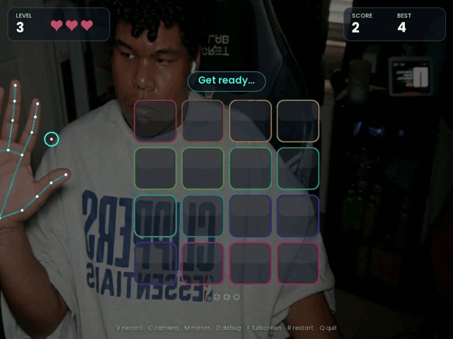
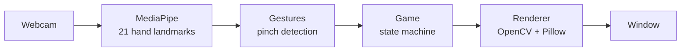

<div align="center">

# Memory Tiles

**A memory game you play with your hands.** Watch the tiles light up, then pinch them back in order using just your webcam.

[](https://github.com/JakeeUp/HandTracking-TileGame/actions/workflows/ci.yml)
[](https://github.com/JakeeUp/HandTracking-TileGame/releases/latest)




[Download](#download) · [How to play](#how-to-play) · [How it works](#how-it-works) · [Run from source](#run-from-source)

</div>

## Features

- **Play with either hand.** Each hand gets its own cursor, so you can alternate hands.
- **Simon-style levels.** The sequence grows by one tile each round, and you get 3 lives.
- **Works with any camera.** Pick it from a dropdown with live preview, including OBS and capture cards.
- **Built-in recording.** Press `V` to record a clip and turn it into a GIF with one command.
- **Remembers you.** Your best score, camera and settings are saved between sessions.

## Download

Grab the latest build from **[Releases](https://github.com/JakeeUp/HandTracking-TileGame/releases/latest)**. No install is needed.

| Platform | File |
| --- | --- |
| Windows | `MemoryTiles.exe` |
| macOS (Apple Silicon) | `MemoryTiles-mac-arm.zip` |
| macOS (Intel) | `MemoryTiles-mac-intel.zip` |

<details>
<summary>macOS first run</summary>

The app is unsigned, so the first time you open it: right-click `MemoryTiles.app`, choose **Open**, then **Open** again.
If the camera prompt doesn't show up, enable it in **System Settings → Privacy & Security → Camera**.
If macOS says the app is damaged, run `xattr -dr com.apple.quarantine MemoryTiles.app`.
</details>

## How to play

1. **Pick your camera** in the settings window and press **Start game**.
2. **Pinch and hold** (thumb and index finger) with either hand to start.
3. **Watch** the tiles light up.
4. **Pinch the tiles in the same order.** A pick counts when you release the pinch.

A wrong tile costs a life and the sequence replays. When you lose all 3 lives, the game is over.

| Key | Action | Key | Action |
| --- | --- | --- | --- |
| `V` | Record video | `F` | Fullscreen |
| `C` | Camera settings | `R` | Restart |
| `M` | Mirror image | `D` | Debug overlay |
| `Q` / `Esc` | Quit | | |

> **Hand moving the wrong way on screen?** Your camera is probably already mirrored, as OBS often is. Press `M` or untick **Mirror image** in settings.

## How it works



Every frame, the game runs this pipeline: [MediaPipe](https://developers.google.com/mediapipe) finds your hands, the gesture layer turns finger positions into clean *press / release* events, the game updates its rules, and the renderer draws the UI over the camera feed.

**Engineering highlights:**

- **Pinches that don't flicker.** The thumb-to-index distance is measured relative to the size of your palm, so it works whether you're close to the camera or far away. Separate press and release thresholds (hysteresis) stop the cursor from rapidly toggling near the edge.
- **No accidental picks.** A tile is chosen when you *release* the pinch, not when you start it. If your hand leaves the frame mid-pinch, the pick is cancelled instead of committed.
- **Robust to tracking mistakes.** MediaPipe sometimes labels both hands "Right". The game detects this and falls back to which side of the screen each hand is on.
- **Testable without a camera.** The game logic never reads the clock; time is passed in. That lets **120+ tests** run in CI on every push with no webcam.
- **Smooth UI on a CPU.** Text is rendered once with a real font and cached, and shapes and glows are cached by size. A full frame draws in about 10 ms.

## Run from source

Requires **Python 3.9–3.12** and a webcam.

```bash
git clone https://github.com/JakeeUp/HandTracking-TileGame.git
cd HandTracking-TileGame
python -m venv .venv
.venv\Scripts\activate            # macOS/Linux: source .venv/bin/activate
pip install -r requirements.txt
python main.py
```

<details>
<summary>Command-line options</summary>

```bash
python main.py --camera 4          # skip the settings window and use camera 4
python main.py --record demo.mp4   # record from launch (V also toggles recording)

# Turn a recording into a GIF (trim with --start/--end, in seconds)
python -m memory_tiles.gif demo.mp4 demo.gif --start 3 --end 12
```
</details>

<details>
<summary>Tuning</summary>

All the tunable values live in [`memory_tiles/config.py`](memory_tiles/config.py): timings, lives, grid size and colors.
If pinching feels too hard or too easy, press `D` in-game, watch the pinch ratio while you pinch and release, and adjust `PINCH_ON_RATIO` and `PINCH_OFF_RATIO`.
</details>

## Development

```bash
pip install -r requirements-dev.txt
pytest          # run the tests
ruff check .    # lint
```

CI runs both on every push and pull request. To release, push a version tag (`git tag v2.1.0 && git push origin v2.1.0`). GitHub Actions then builds the Windows and macOS apps and publishes them to Releases.

<details>
<summary>Project layout</summary>

| Module | What it does |
| --- | --- |
| [`app.py`](memory_tiles/app.py) | Entry point and game loop |
| [`launcher.py`](memory_tiles/launcher.py) | Camera settings window with live preview |
| [`cameras.py`](memory_tiles/cameras.py) | Finds cameras by name and opens them |
| [`hand_tracking.py`](memory_tiles/hand_tracking.py) | MediaPipe wrapper: frame → hand landmarks |
| [`gestures.py`](memory_tiles/gestures.py) | Landmarks → pinch press/release events |
| [`game.py`](memory_tiles/game.py) | Rules and state machine (pure, no I/O) |
| [`geometry.py`](memory_tiles/geometry.py) | Grid layout and hit-testing |
| [`renderer.py`](memory_tiles/renderer.py) | Draws everything |
| [`text.py`](memory_tiles/text.py) | Font rendering |
| [`recorder.py`](memory_tiles/recorder.py) / [`gif.py`](memory_tiles/gif.py) | Video recording and GIF export |
| [`settings.py`](memory_tiles/settings.py) | Saved settings and best score |
| [`config.py`](memory_tiles/config.py) | Tunable constants |
</details>

## Built with

[Python](https://www.python.org/) · [MediaPipe](https://developers.google.com/mediapipe) · [OpenCV](https://opencv.org/) · [Pillow](https://python-pillow.org/) · [Poppins font](https://fonts.google.com/specimen/Poppins) (SIL Open Font License)
